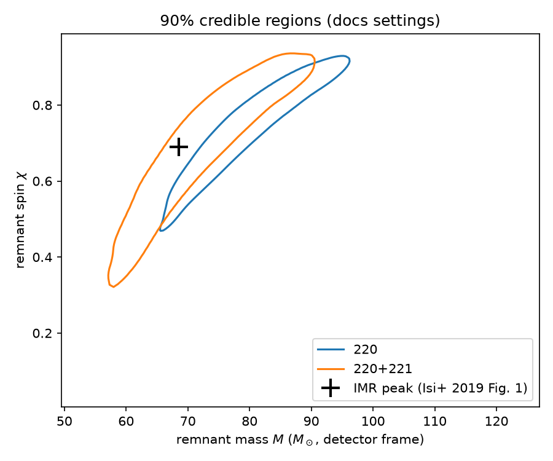
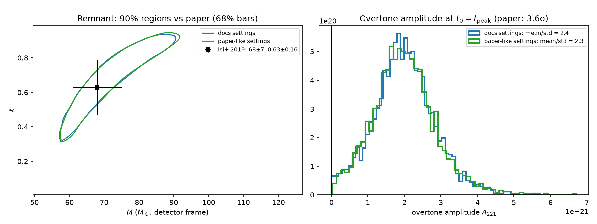
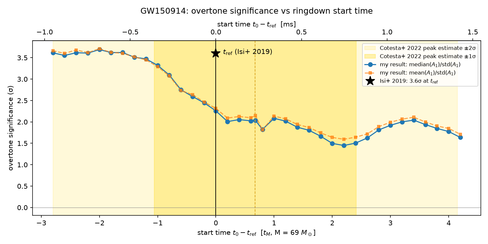
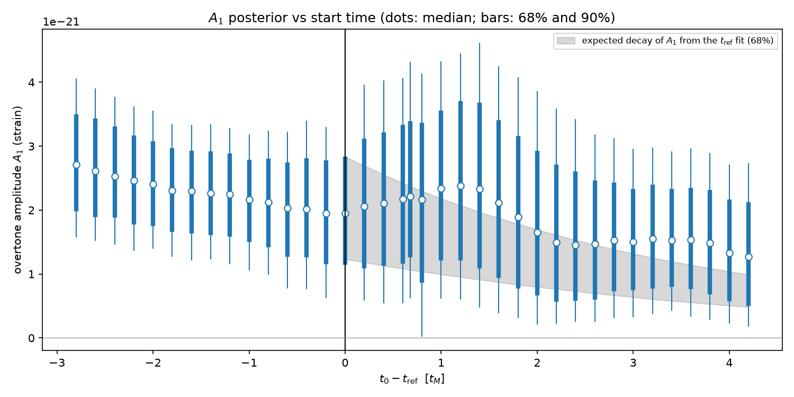

# Ringdown Iterate: is the GW150914 overtone real, or a choice of start time?

ITERATE stage of my TKS Focus Project. In my Build I fitted damped sinusoids
to simulated data in white noise. Here I repeat the idea on **real LIGO data**
for GW150914, using the open-source [`ringdown`](https://github.com/maxisi/ringdown)
package by Isi & Farr.

## The question

Isi et al. 2019 reported the first overtone (the "221" mode) of the
GW150914 remnant black hole at **3.6σ**, using data starting at the signal
peak. Cotesta et al. 2022 argued that this evidence changes a lot when the
start time is moved by less than a millisecond; Isi & Farr 2022 replied that
they could not reproduce that.

**My question:** if I repeat the 220+221 analysis at many start times, how
much does the overtone significance change, and how does that compare with
the claimed 3.6σ? That tests my thesis that *modelling choices (like start
time) can matter as much as noise*.

## Data

* GW150914 strain from the [Gravitational Wave Open Science Center](https://gwosc.org/eventapi/html/GWTC-1-confident/GW150914/v3/),
  Hanford (H1) and Livingston (L1), 16 kHz, release R1.
  * 32 s files (used by the `ringdown` docs example).
  * 4096 s files (used by Isi & Farr 2022, and for the noise estimate).
* Every file is checked against its published MD5 checksum.

## Method (short)

1. **Noise**: estimate each detector's noise spectrum (PSD) from 1024 s of
   data away from the event (Welch method), and whiten the data.
2. **Model**: a sum of damped sinusoids whose frequencies and damping times
   are fixed by the remnant's mass $M$ and spin $\chi$ (Kerr), projected
   onto each detector with its antenna pattern and time delay.
3. **Likelihood**: time-domain, using only data *after* the start time $t_0$,
   with the noise autocovariance from step 1.
4. **Sampler**: Hamiltonian Monte Carlo (numpyro NUTS), 4 chains.
5. **Significance** of the overtone: how many standard deviations the
   overtone amplitude posterior sits away from zero (mean/std, as in Isi+ 2019;
   median/std, as in Isi & Farr 2022).
6. **Start-time scan**: repeat at $t_0 - t_{\rm ref}$ from −2.8 to +4.2
   $t_M$ in steps of 0.2 $t_M$ ($t_M = GM/c^3 = 0.34$ ms for $M = 69\,M_\odot$),
   covering the Isi & Farr 2022 grid and Cotesta+ 2022's ±2σ peak-time range.

Every reference number, with the exact paper and line it comes from, is in
[papers/PAPER_NUMBERS.md](papers/PAPER_NUMBERS.md).

## How to run

Needs Linux or macOS (LIGO's `lalsuite` has no Windows build). On Windows
I use WSL (Ubuntu).

```bash
# one-time setup (Python 3.12 via uv)
uv python install 3.12
uv venv --python 3.12 ~/venvs/ringdown-iterate
VIRTUAL_ENV=~/venvs/ringdown-iterate uv pip install -r requirements.txt
```

`requirements-lock.txt` pins the exact versions I ran with (ringdown 1.1.0,
lalsuite 7.26.4, jax 0.6.0, numpyro 0.19.0); install from it instead to
reproduce my numbers exactly.

```bash
# run everything (downloads ~1 GB of data the first time)
VENV=~/venvs/ringdown-iterate bash run.sh all
```

```bash
# or one step at a time
VENV=~/venvs/ringdown-iterate bash run.sh 01_get_data 02_noise
```

Each `notebooks/NN_*.py` file becomes an executed `notebooks/NN_*.ipynb`
with all the outputs. Figures go to `figures/`, numbers to `results/`.

A full run on my laptop (Intel i5-1345U, 16 GB, WSL Ubuntu): data download
~15 min, Step 2 ~15 min, Step 3 ~30 min, Step 4 ~7 min, the 37-point scan
~1.5 h when nothing else is running. One fit needs ~4 GB of RAM.

The project page is live at
**https://leonardoperugia09-cyber.github.io/ringdown-iterate/** (source:
[docs/index.html](docs/index.html)); it has an interactive start-time slider
fed by the real scan.

## Results

### Step 3: the docs example is reproduced

| 220+221, docs settings | M (M⊙, detector frame) | χ |
|---|---|---|
| my run | 72.3 ± 8.1 | 0.68 ± 0.16 |
| ringdown docs page | 72.1 ± 8.2 | 0.68 ± 0.17 |

The fundamental-only model gives M = 79.8 ± 7.4, χ = 0.74 ± 0.12, biased
away from the IMR value, like Fig. 1 of Isi+ 2019.



### Step 4: against Isi et al. 2019, at their start time

| | M (M⊙) | χ | overtone significance (mean/std) |
|---|---|---|---|
| Isi+ 2019 (line 160, Fig. 2 caption) | 68 ± 7 | 0.63 ± 0.16 | **3.6σ** |
| my paper-like run | 72.8 ± 8.2 | 0.69 ± 0.17 | **2.3σ** |
| my docs-settings run | 72.3 ± 8.1 | 0.68 ± 0.16 | 2.4σ |

Mass and spin agree within the error bars. The significance does **not**
reproduce: 2.3σ, not 3.6σ. The amplitude prior is not the cause (flat and
Gaussian priors give almost the same posterior). Remaining differences from
the 2019 analysis: noise autocovariance from 4096 s with ringdown 1.1.0
defaults (2019: 64 s off-source), numpyro HMC in float32 (2019: kombine),
and software version. Cotesta+ 2022 say such differences give "moderately
different overtone amplitudes", and cite a third reanalysis at 1.8σ. I did
not test which difference matters most.



### Step 5: the start-time scan



| t₀ − t_ref (t_M) | −2.8 … −1.6 | −1.0 | −0.6 | 0 | +0.68 | +1.0 | +2.0 | +3.4 | +4.2 |
|---|---|---|---|---|---|---|---|---|---|
| mean/std | 3.5–3.7 | 3.3 | 2.7 | 2.3 | 2.1 | 2.1 | 1.6 | 2.1 | 1.7 |

Full table: [results/05_scan_summary.csv](results/05_scan_summary.csv).
1 t_M = 0.34 ms (M = 69 M⊙, as in Isi & Farr 2022). t_ref = GPS
1126259462.423 at H1. +0.68 t_M is Cotesta+ 2022's median peak time.



## Interpretation (Step 6)

What my plot shows:

1. **The significance changes smoothly with start time.** Neighbouring
   start times 0.07 ms apart differ by at most 0.34σ. I do not see the
   sharp drop just before and after t_ref that Cotesta+ 2022 describe; on
   this point my result looks more like Isi & Farr 2022.
2. **But the start time moves the answer as much as the noise does.**
   Inside Cotesta+ 2022's ±1σ range for the true peak time
   (−1.06 … +2.42 t_M), the significance runs from 3.3σ to 1.6σ. Isi & Farr
   2022's injections show a scatter of about ±1σ from noise alone. So in
   this analysis one modelling choice, the start time, matters about as
   much as the noise.
3. **3.6σ only appears for early start times.** My fit reaches 3.6σ only
   when it starts ≥ 1.6 t_M (0.54 ms) before t_ref, where Isi & Farr 2022
   see the Kerr model start to fail (~−1.5 t_M) and Cotesta+ 2022 say the
   overtone model is not well motivated.
4. **The amplitude itself behaves like a decaying overtone.** In the second
   plot, the A₁ medians after t_ref stay close to or inside the band
   expected if the overtone measured at t_ref simply decays with
   τ₂₂₁ ≈ 1.5 ms (my fit). The significance drops mainly because the
   posterior gets wider when the fit starts later. Across the scan the
   remnant mass drifts from 76 to 66 M⊙.

What this says about my thesis: it supports "modelling choices can matter
as much as noise", for this event, with this pipeline. It does **not** show
that the overtone is absent, or that Isi+ 2019 or Cotesta+ 2022 is right.

## Limitations

* One event, one noise realisation, no injection study of my own.
* My significance at t_ref (2.3σ) does not match the paper (3.6σ); the cause
  is not isolated.
* mean/std is not a full detection test; no Bayes factors computed.
* The start time is scanned, not marginalised over; the true peak time is
  taken from Cotesta+ 2022, not measured here.
* Only the 220 and 221 modes; frequencies fixed to Kerr (no GR test).
* ringdown 1.1.0 samples in single precision by default.

## Sources

Every reference number is in [papers/PAPER_NUMBERS.md](papers/PAPER_NUMBERS.md)
with its file and line. Papers: Isi et al. 2019 (arXiv:1905.00869),
Cotesta et al. 2022 (arXiv:2201.00822), Isi & Farr 2022 (arXiv:2202.02941).
Data: LIGO Scientific Collaboration via GWOSC. Code: `ringdown` by Isi & Farr.
Photos and clip on the page: see the credits in its footer.
